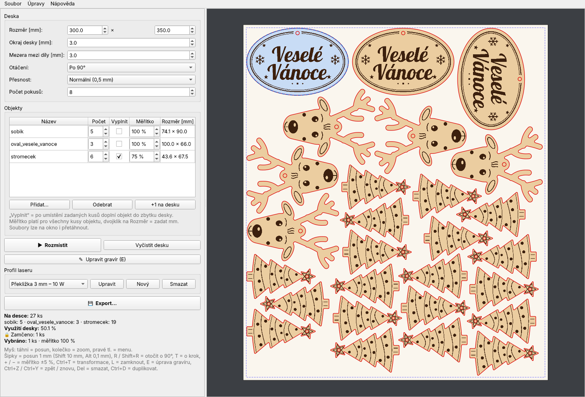

<h1 align="center">LaserNest</h1>

<p align="center"><b>Rozmístění dílů na desku pro diodové lasery – jako slicer pro 3D tisk.</b></p>

<p align="center">
Nesting podle skutečného tvaru s otáčením, gravír i řez vždy ve správném pořadí,
export do G-code, SVG a PNG pro LaserGRBL a LightBurn – jeden program, bez instalace.
</p>

<p align="center">
  <a href="https://github.com/1519105/LaserNest/releases/latest"></a>
  
  
  
  <a href="LICENSE"></a>
</p>

---

## Obsah

- [Co umí](#co-umí)
- [Stažení](#stažení)
- [Postup](#postup)
- [Použití s LaserGRBL – krok za krokem](#použití-s-lasergrbl--krok-za-krokem)
- [Spuštění ze zdrojáků](#spuštění-ze-zdrojáků)
- [Jak funguje nesting](#jak-funguje-nesting)

---

## Co umí

| Oblast | Funkce |
|---|---|
| **Deska** | Rozměr, okraj od kraje, mezera mezi díly, kontrola kolizí a přesahů |
| **Objekty** | Řez (SVG) + gravír (PNG/JPG/SVG), nebo jen gravír; automatické párování souborů a rozpoznání řezu/gravíru podle obsahu; drag & drop |
| **Rozmístění** | Podle skutečného obrysu, otáčení po 180° / 90° / 45° / 15°, víc pokusů, „Vyplnit zbytek desky“, **zamčené díly zůstanou a doskládá se jen zbytek**, „+1 na desku“ |
| **Měřítko** | Pro všechny kusy objektu (sloupec v tabulce, nebo rozměr v mm) i pro jednotlivé kusy na desce (`+` / `−`, Ctrl+T s přesným úhlem); vždy rovnoměrné, s upozorněním na malé otvory a zubatý gravír |
| **Ruční úpravy** | Posun myší i šipkami (1 / 10 / 0,1 mm), otáčení, duplikace, zamykání, **Zpět / Znovu** (Ctrl+Z / Ctrl+Y) |
| **Úprava gravíru** | Kliknutím smažeš část gravíru (tečku, nápis…) u všech kusů objektu; jde vrátit |
| **Export** | G-code (gravír M4 → řez M3), pořadí *nejdřív gravír* nebo *po dílech*, volitelná pauza M0; PNG + SVG pro LaserGRBL; barevné SVG pro LightBurn / Inkscape |
| **Rám (framing)** | Samostatný soubor nebo začátek G-code + pauza; obdélník nebo obrys tvarů; nastavitelný výkon (0 % = laser vypnutý) a rychlost |
| **Řez** | Můstky (počet a šířka) proti vypadnutí dílů, kompenzace šířky řezu (kerf) z profilu; nejdřív otvory, pak obrys |
| **Optimalizace** | Řazení dílů podle nejkratší cesty; gravír po souvislých ostrůvcích bez přejezdů přes desku; odhad času |
| **Profily** | Rychlost, výkon, hustota řádků, průchody, kerf, max. S (`$30`), air assist – ukládají se a pamatují |
| **Projekty** | Uložení a otevření celé desky (`.lnest`) |



## Stažení

Hotové programy jsou v [Releases](../../releases) (sestaví se automaticky po každé změně v `main`):

- **Windows:** `LaserNest-windows-x64.exe` – stačí spustit (bez instalace).
- **Linux:** `LaserNest-linux-x86_64` – `chmod +x` a spustit.
  Na Ubuntu/Debianu může být potřeba `sudo apt install libxcb-cursor0`.

K pálení je potřeba program, který posílá G-code do laseru – doporučujeme
**LaserGRBL** (zdarma, Windows): oficiální web **[lasergrbl.com](https://lasergrbl.com)**,
zdrojáky a vydání na **[github.com/arkypita/LaserGRBL](https://github.com/arkypita/LaserGRBL/releases)**.
Stahuj jen odtud – jiné „download“ weby často přibalují reklamy nebo malware.

## Postup

1. **Deska** – rozměr (např. 300 × 350 mm), okraj od kraje a mezera mezi díly.
2. **Přidat…** – soubor řezu (SVG) a gravíru (PNG nebo SVG). Pokud se jmenují
   `něco_2_rez.svg` + `něco_1_gravir.png`, druhý soubor se doplní sám.
   Soubory jde také přetáhnout myší na okno. Stačí i **jen obrázek** (JPG/PNG)
   bez řezu – zadej jeho šířku v mm a díl se jen vygravíruje.
3. Zadej **počet** kusů a případně **měřítko** (sloupec *Měřítko*, nebo dvojklik na
   *Rozměr* a zadat šířku/výšku v mm). Zatržení **Vyplnit** doplní objekt do zbytku desky.
4. **▶ Rozmístit.** Pak lze díly ručně doladit (viz klávesy níže). Kolize se zobrazí
   červeně. Díly, které chceš nechat, **zamkni (`L`)** – další *Rozmístit* je nechá
   na místě a doskládá jen zbytek. **+1 na desku** přidá jeden kus na volné místo.
5. Volitelně **✎ Upravit gravír (`E`)** – klikni na část gravíru, kterou nechceš pálit.
6. **Export…** – formáty, pořadí, můstky a rám.

### Ovládání

| Akce | Klávesa / myš |
|---|---|
| Posun dílu | tažení myší, **šipky** 1 mm, **Shift+šipky** 10 mm, **Alt+šipky** 0,1 mm |
| Otočit o 90° / o krok | `R`, `Shift+R` / `T` |
| Měřítko kusu ±5 % | `+` / `−` |
| Přesné měřítko a úhel | `Ctrl+T` (nebo pravé tlačítko → Transformace…) |
| Zamknout / odemknout | `L` |
| Úprava gravíru (mazání kliknutím) | `E` |
| Zpět / znovu | `Ctrl+Z` / `Ctrl+Y` |
| Duplikovat / smazat | `Ctrl+D` / `Del` |
| Zoom / celá deska | kolečko myši / `F` |

### Co se exportuje

| Soubor | K čemu |
|---|---|
| `deska.svg` | Jedno SVG s barvami: **černá výplň = gravír**, **červená čára = řez** – pro **LightBurn / Inkscape**. ⚠ **Ne pro LaserGRBL** (výplně neumí, gravír by jen obkreslil obrysy) |
| `deska_1_gravir.png` + `deska_2_rez.svg` | Pro **LaserGRBL** – obojí má plátno přesně rozměr desky, načítej s offsetem 0/0 |
| `deska.gcode` | Hotový G-code: gravír (M4) a řez (M3) v jednom souboru (nebo zvlášť), pořadí *nejdřív gravír* nebo *po dílech* |
| `deska_0_ram.gcode` | **Rám** – laser objede oblast úlohy (obdélník nebo obrys tvarů) slabým paprskem nebo s vypnutým laserem |

**Pořadí po dílech** – u každého dílu se nejdřív vygravíruje a hned vyřízne. Hodí se,
když se deska teplem kroutí nebo se díly po prořezání pohnou.
**Můstky** – na vnějším obrysu zůstane zadaný počet neprořezaných kousků (např. 3 × 0,5 mm),
díl drží v desce a pak se jen vylomí. **Kerf** – obrys se posune ven a otvory dovnitř
o polovinu šířky řezu, aby díly měly přesný rozměr (nastavuje se v profilu laseru).

Řez jde vždy **nejdřív otvory, potom vnější obrys** každého dílu, díly jsou
seřazené tak, aby hlava zbytečně nejezdila. Gravír se pálí po souvislých
ostrůvcích (bez přejíždění přes celou desku).

### G-code a profily

Profil = rychlost a výkon pro gravír a řez, hustota řádků, počet průchodů,
max. S (GRBL `$30`) a air assist (M8/M9). Profily se ukládají do
`%APPDATA%\LaserNest\profiles.json` (Windows) nebo `~/.config/LaserNest/` (Linux).

- GRBL musí mít **laser mode `$32=1`**.
- Nula G-code je **levý dolní roh desky** (nebo levý horní – volba v exportu).
- Výchozí profily (překližka 3 mm, 5 W / 10 W) jsou orientační – **vždy ověř testem**.
- **Rám:** u diody bez ukazovátka nastav výkon 0,5–1 % – je vidět jako slabá tečka a nepálí.
  Vždy s ochrannými brýlemi.

### Vstupní soubory

- **Řez:** SVG s čarami (cesty, křivky, kruhy, obdélníky…). Jednotky se berou
  z SVG (mm, nebo px při 96 DPI jako Inkscape).
- **Gravír:** PNG/JPG/BMP (černobílý, práh 50 %) nebo SVG s vyplněnými tvary.
  Musí mít **stejné plátno jako řez** (stejný počátek vlevo nahoře) – rozměr
  rastru se přepočítá na šířku plátna řezu.

## Použití s LaserGRBL – krok za krokem

### Jednorázová příprava

1. Připoj laser, v LaserGRBL zvol **COM port** a **115200** baud, připoj se (zelená ikona).
2. **Grbl → Grbl Configuration**: zkontroluj **`$32 = 1`** (laser mode) a hodnotu
   **`$30`** (max. S, obvykle 1000). Stejné `$30` nastav v profilu LaserNest
   jako „Max. S“ – jinak nebude sedět výkon v %.
3. V LaserNest si v **Profil laseru → Upravit** nastav rychlosti a výkony
   pro svůj materiál (vyzkoušej na odřezku a ulož – profil se pamatuje).

### Každá deska

1. **LaserNest:** rozměr desky → přidat objekty → počty → **▶ Rozmístit** →
   případně ručně doladit → **Export…**
2. Polož desku do laseru, najeď hlavou na **levý dolní roh desky** (při
   exportu s nulou „levý dolní roh“) a nastav tam **pracovní nulu**
   (v konzoli LaserGRBL `G92 X0 Y0`, nebo tlačítkem nastavení nuly).
3. Dál jedna ze dvou cest:

#### A) Hotový G-code (doporučeno)

1. **Rám:** **File → Open File →** `deska_0_ram.gcode` → **▶ Run**. Laser objede
   oblast úlohy – zkontroluj, že leží na desce. Případně posuň desku nebo nulu a opakuj.
   (Nebo zapni v exportu „Rám i na začátek G-code“ – laser rám objede, zastaví se
   a po kontrole pokračuješ tlačítkem **Resume / Cycle start**.)
2. **File → Open File →** `deska.gcode`.
3. V náhledu zkontroluj, že díly leží uvnitř desky (osa Y roste od spodního
   okraje – díly nahoře na desce mají velké Y, to je správně). Dlouhé tenké
   čáry jsou jen přejezdy s vypnutým laserem.
4. **▶ Run.** Laser sám vygravíruje a vyřízne (podle zvoleného pořadí). Při volbě
   „Pauza (M0)“ se mezi gravírem a řezem zastaví – pokračuj tlačítkem
   **Resume / Cycle start** (třeba po kontrole gravíru nebo výměně čočky).

Rychlost a výkon jsou už v G-code z profilu, v LaserGRBL se nic nenastavuje.
Gravír a řez jde exportovat i do **dvou souborů** (Export → Obsah) a spustit je
postupně.

#### B) Obrázek gravíru + SVG řezu

Hodí se, když chceš rychlosti/výkony ladit přímo v LaserGRBL.

1. **File → Open File →** `deska_1_gravir.png`
   - **Line To Line Tracing**, kvalita **10 lines/mm** (nebo co máš v profilu),
     směr Horizontal.
   - V dalším okně: rychlost gravíru, S-MAX (výkon), **velikost přesně
     rozměr desky** (např. 300 × 350 mm) a **Offset X/Y = 0**.
   - Vypal.
2. **Neposouvej desku ani nulu.** **File → Open File →** `deska_2_rez.svg`
   - Laser mode **M3 – Constant Power**, rychlost a S-MAX pro řez,
     **Color filter: All**, velikost opět **rozměr desky**, **Offset 0/0**.
   - Počet průchodů nastav vpravo dole (Passes) a vyřízni.

Oba soubory mají plátno přesně jako deska, proto při stejné velikosti a
offsetu 0/0 gravír a řez přesně sedí na sebe.

### Časté problémy

| Problém | Příčina / řešení |
|---|---|
| Barevné `deska.svg` v LaserGRBL dělá z teček kroužky / zasekne se na „Loading“ | LaserGRBL u SVG neumí výplně – použij **G-code** nebo **PNG + SVG řezu** |
| Gravír a řez na sebe nesedí | Jiná velikost nebo offset při načtení (musí být rozměr desky a 0/0), nebo se mezi kroky posunula nula/deska |
| Výkon neodpovídá % | „Max. S“ v profilu ≠ `$30` v GRBL |
| Na začátku řádků je gravír tmavší | Chybí `$32=1` (laser mode) |
| Díly jsou mimo desku | Nula G-code je jinde než při exportu (levý dolní × levý horní roh) |
| U objektu je text červeně (řeže se) | Prohozený soubor řezu a gravíru – od verze 0.1.2 to program pozná a opraví sám |

## Spuštění ze zdrojáků

```bash
pip install -r requirements.txt
python main.py
```

Sestavení vlastního exe/binárky: `pip install pyinstaller && python build.py`.
Testy: `python tests/test_core.py`. Kontrola G-code: `python tools/gcode_preview.py deska.gcode nahled.png`.

## Jak funguje nesting

Deska se převede na rastr obsazenosti (0,5 mm). Pro každý díl a natočení se
připraví maska obrysu zvětšená o polovinu mezery a všechna volná místa se
najdou najednou přes FFT. Díl jde na místo „co nejvýš a nejvíc vlevo“,
zkusí se několik pořadí a vezme se nejlepší. Výsledek se ověří přesnou geometrií.
